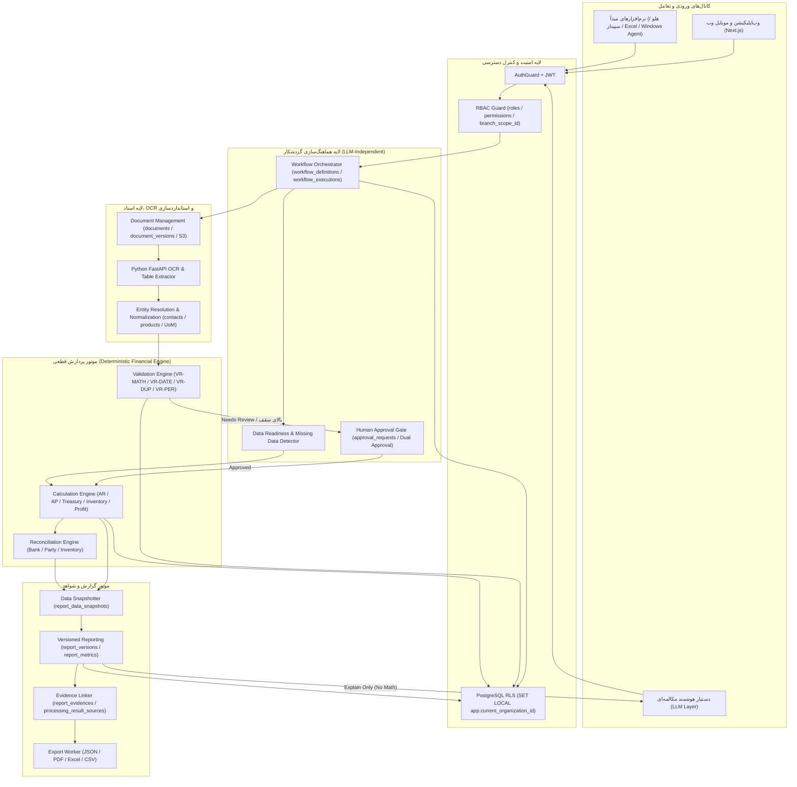

# 00 — نمای کلی مشخصات خدمات، پردازش‌های مالی و گردشکارها (`Processing & Workflow Overview`)

**پروژه:** `Erpkian` — پلتفرم هوشمند دریافت اسناد، پردازش مالی و تحلیل کسب‌وکار  
**مرحله:** چهارم (`Stage 4: Service & Workflow Specification`)  
**وضعیت:** سند مرجع عملیاتی، قابل پیاده‌سازی و قابل آزمون  
**مبنای بالادستی:** `docs/PRD.md` و معماری داده مرحله سوم (`docs/data-model/00`..`15`)

---

## ۱. هدف و دامنه مرحله چهارم
این مجموعه اسناد، طراحی مفهومی مرحله دوم و مدل داده ۱۰۹ جدولی مرحله سوم را به **قراردادهای دقیق اجرایی** تبدیل می‌کند تا تیم‌های Backend (`NestJS`)، پردازش اسناد (`Python FastAPI`)، Frontend (`Next.js`) و کنترل کیفیت (`QA`) بتوانند هر سرویس را بدون ابهام پیاده‌سازی و آزمایش کنند.

### اصول حاکم بر تمام مشخصات مرحله چهارم
1. **جداسازی کامل موتور قطعی از هوش مصنوعی (`Deterministic Engine vs LLM`):** هیچ محاسبه مالی، تجمیع، مالیات یا تطبیقی توسط مدل زبانی انجام نمی‌شود. LLM صرفاً در تشخیص نیت (`Intent Detection`)، راهنمایی کاربر، استخراج اولیه ساختار از OCR و توضیح نتایج قطعی (`Explain Only`) نقش دارد.
2. **مالکیت داده و مدل `Sub-ledger First`:** در نسخه اول، هسته عملیاتی بر پایه جداول `invoices`، `payments`، `payment_allocations`، `checks`، `bank_transactions`، `inventory_movements` و `financial_adjustments` عمل می‌کند؛ جداول دفترکل (`accounting_entries`) به عنوان قلاب توسعه آتی حفظ شده‌اند.
3. **چندسازمانی (`Multi-Tenant`) و دسترسی مبتنی بر مجوز (`Permission-Based RBAC`):** هر سرویس پیش از اجرا، عضویت فعال (`organization_memberships`)، مجوز `resource:action` و محدوده شعبه (`branch_scope_id`) را بررسی می‌کند و در دیتابیس تحت `PostgreSQL RLS` (`SET LOCAL app.current_organization_id`) اجرا می‌شود.
4. **چرخه‌عمر استاندارد اسناد و داده‌های مالی:**
   - **چرخه‌عمر سند ورودی (`documents.lifecycle_status`):** `Uploaded -> Processing -> Needs Review -> Verified -> Eligible for Posting -> Posted` (و وضعیت انتهایی `Rejected`).
   - **چرخه‌عمر رکورد مالی (`invoices` / `payments`):** `Needs Review -> Verified -> Posted -> Reversed | Cancelled`.
   - **قانون قطعی گزارش‌گیری:** داده‌های `Needs Review` و `Verified` به صورت پیش‌فرض وارد محاسبه رسمی نمی‌شوند؛ یا صرفاً با تفکیک و هشدار صریح در حالت پیش‌نویس نمایش داده می‌شوند و همیشه `report_data_snapshots` تعداد اسناد لحاظ‌شده و معلق را ثبت می‌کند.
5. **شفافیت در ناقص بودن داده و ردگیری شواهد (`Evidence & Confidence`):** هر عدد خروجی در گزارش‌ها از طریق `report_evidences` و `processing_result_sources` به رکورد مالی و سند تصویری/فایل مبدأ قابل ردیابی است.
6. **تفکیک اکید مالیات و انطباق:** خدمات مالیاتی به سه لایه مجزا تفکیک شده‌اند: **تحلیل و آماده‌سازی**، **اعتبارسنجی** و **ارسال رسمی (قفل‌شده در نسخه اول و مشروط به مجوز/گواهی رسمی)**.

---

## ۲. نقشه اسناد مرحله چهارم (`docs/processing/`)

| نام فایل | موضوع | مخاطب اصلی |
|---|---|---|
| `00-processing-overview.md` | نمای کلی، اصول حاکم و ۶ نمودار معماری و گردشکار | همه تیم‌ها |
| `01-service-catalog.md` | کاتالوگ جامع ۶۲ خدمت در ۹ دسته (`A..I`) | محصول، Backend، QA |
| `02-service-prioritization.md` | ماتریس اولویت‌بندی `P0..P3` و وابستگی خدمات | محصول، معماری |
| `03-processing-specifications.md` | قرارداد کامل ۲۰ بخشی مشخصات پردازش تمام خدمات | Backend، AI/OCR، QA |
| `04-workflow-specifications.md` | مشخصات ۱۳ مرحله‌ای گردشکارهای مستقل از LLM | Orchestrator، Backend |
| `05-role-permission-matrix.md` | ماتریس مجوزهای ۹ نقش × ۱۲ قابلیت + تایید دوامضایی | امنیت، Backend، UI |
| `06-scenario-library.md` | ۳۰ سناریوی واقعی و قابل تست (`Synthetic`) در ۵ صنعت | QA، محصول، Backend |
| `07-validation-rules.md` | قوانین اعتبارسنجی ریاضی، تاریخ شمسی، ارز، تکراری و قفل دوره | Backend، OCR، QA |
| `08-calculation-formulas.md` | فرمول‌های قطعی محاسبات با مثال عددی و حالات مرزی | Backend، مالی، QA |
| `09-output-contracts.md` | قراردادهای استاندارد خروجی JSON، PDF، Excel، CSV و شواهد | Backend، Frontend |
| `10-acceptance-criteria.md` | معیارهای پذیرش و حداقل ۳ تست مستقل برای هر سرویس P0 | QA، محصول |
| `11-open-decisions.md` | جمع‌بندی و تصمیم پیشنهادی برای ۱۲ تصمیم باز مرحله سوم | مالک محصول، معماری |
| `12-stage4-traceability.md` | نگاشت سرویس‌ها/گردشکارها به جداول مرحله ۳ + پیش‌نویس Migration 011 | معمار داده، Backend |

---

## ۳. نمودارهای معماری و گردشکارهای کلیدی

> فایل‌های مستقل `.mmd` نیز در همین پوشه (`docs/processing/diagram-*.mmd`) ذخیره شده‌اند.

### ۳.۱. معماری لایه‌ای خدمات و پردازش (`Service Architecture`)

### ۳.۲. گردشکار ثبت فاکتور (`WF-INV-REG-001`)
فایل مرجع: `diagram-wf-invoice.mmd` — کنترل چرخه‌عمر، بررسی دوره باز، تبدیل واحد سنجش، دروازه تایید دوامضایی و قفل Idempotency.

### ۳.۳. گردشکار OCR و استخراج اسناد (`WF-DOC-OCR-001`)
فایل مرجع: `diagram-wf-ocr.mmd` — کنترل فایل تکراری SHA-256، ذخیره نسخه اصلی، ارزیابی وضوح، استخراج فیلد و جدول، کنترل حسابی، تطبیق موجودیت و اصلاح انسانی.

### ۳.۴. گردشکار مغایرت‌گیری بانکی (`WF-BANK-REC-001`)
فایل مرجع: `diagram-wf-bank-reconcile.mmd` — تطبیق چندمرحله‌ای قطعی، چک صیاد، تطبیق احتمالی با تلرانس و مدیریت استثناهای باز.

### ۳.۵. گردشکار تحلیل بدهی معوق و گزارش سنی (`WF-AR-AGING-001`)
فایل مرجع: `diagram-wf-ar-aging.mmd` — بررسی اسناد معلق، ثبت Snapshot، محاسبه مانده باز با `payment_allocations`، تفکیک چک در جریان وصول و صدور بسته خروجی.

### ۳.۶. گردشکار تولید و نسخه‌بندی گزارش‌ها (`WF-RPT-GEN-001`)
فایل مرجع: `diagram-wf-reporting.mmd` — جلوگیری از بازنویسی بی‌صدای گزارش‌های قبلی با `report_versions (v1 -> v2)`، ثبت `report_metrics` و اتصال `report_evidences`.
